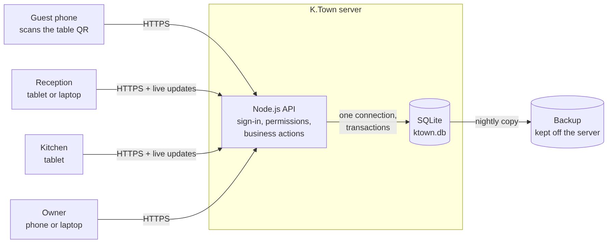
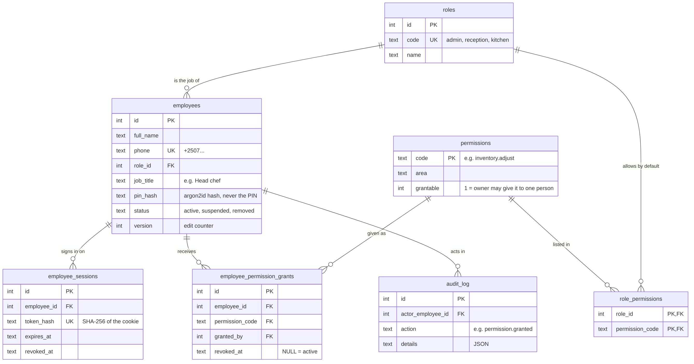
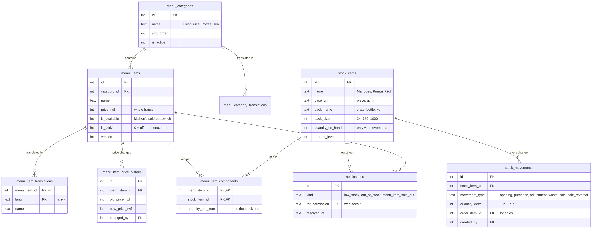
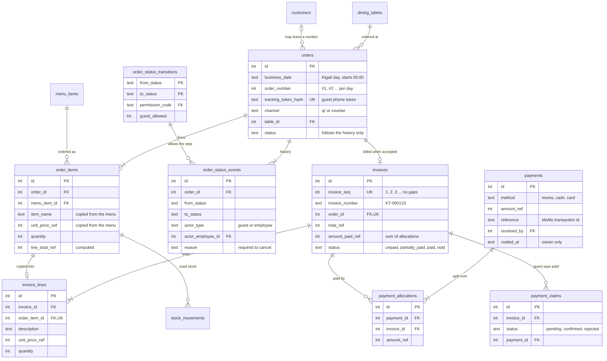
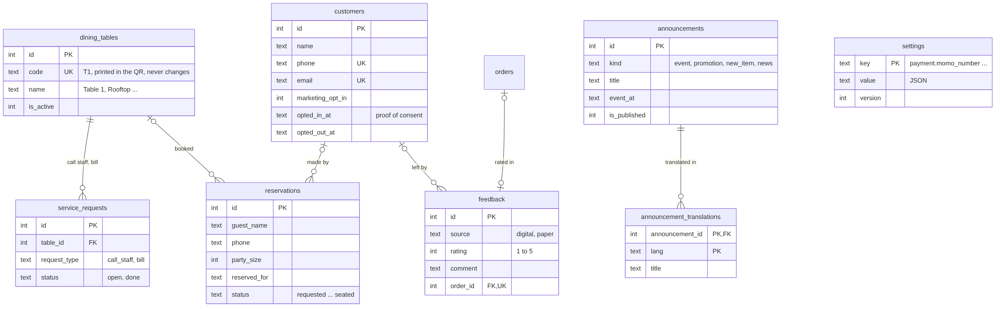
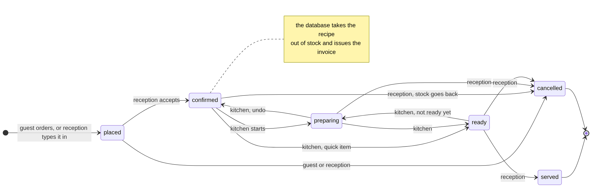

# K.Town database design

**Version 1.0 · 31 October 2026 · Status: proposed, for review**

This is the database for the rebuilt K.Town system: a React frontend, a Node.js API and an SQLite database. It replaces the browser storage of the first version and the plan to use Firebase.

Files:

| File | What it is |
|---|---|
| `database/schema.sql` | Every table, view and rule, with a comment on each |
| `database/seed.sql` | Reference data: roles, permissions, the order life cycle, settings, the 4 tables and the menu |
| `database/sample-data.sql` | Development data only: demo staff, stock and example recipes |
| `database/test/` | 58 automated tests; each rule in this document has at least one |
| `docs/diagrams/*.mmd` | Sources of the pictures below (Mermaid) |

---

## 1. Why a redesign

The first version (v1.0.1) was a prototype for presenting. In its "demo mode" each browser kept its own copy of the data, and real use depended on Firebase. The code review found three problems that would break it in daily use:

| Review finding | Cause in v1 | What this design does |
|---|---|---|
| The data is not persistent | Orders, menu and payments lived in each browser (localStorage) | One SQLite database on the server is the only copy of the truth. Phones and screens only show it. Nothing that matters is kept in a browser. Nightly backups. |
| The order tracker moves by itself | A demo "autopilot" moved orders forward when no staff screen was open | A status changes only by recording a step in `order_status_events`, made by an employee who has the permission for that step, or by a guest cancelling their own order before it is accepted. A direct `UPDATE orders SET status = …` is refused by the database. Every step stores who did it and when. |
| Reception can change the stock | The reception screen had a "Stock" button | Access is by permission. Reception has none of the stock permissions, and the database itself refuses stock changes from anyone without them. The kitchen can mark a dish sold out; stock quantities change only by people the owner gives stock access to, such as the head chef. |

The restructure meeting added staff accounts with roles and permissions, inventory management, invoices generated from orders, and the React / Node.js / SQLite stack.

## 2. Requirements and where they are handled

| Who | Requirement | Where |
|---|---|---|
| Owner | Add, change and remove employees, assign roles | `employees`, `roles`. Only the owner (`employees.manage`) can do it. Removing sets status `removed`: history stays, and the person is signed out everywhere at once. |
| Owner | Give access to the inventory system | `employee_permission_grants`: for example the head chef gets `inventory.adjust`. Can be taken back. Every grant and revoke is logged. |
| Owner | Update the stock: add a product, remove a product, change quantities | Add or switch off a product in `stock_items`; change quantities with `stock_movements` (purchase, count correction, waste). |
| Owner, Reception | See orders and their history | `v_order_summary`, `v_order_timeline` (permission `orders.view`) |
| Owner, Reception | See paid and unpaid orders | Invoice status `unpaid`, `partially_paid`, `paid` or `void`, shown in `v_order_summary` |
| Reception | Invoice generated automatically, matching the prices ordered | The database issues it the moment reception accepts the order; its lines are copied from the order and checked |
| Reception | Book tables (can wait) | `reservations`: designed now, built in phase 2 |
| Kitchen | Receive orders from reception | An order reaches the kitchen only after reception accepts it (status `confirmed`) |
| Kitchen | Say that something is out of stock | The sold-out switch on a menu item (`menu.availability`) tells reception at once. Tracked stock raises "low" and "out" alerts by itself. |
| Kitchen (head chef) | Update the stock when the owner allows it | The `inventory.*` permissions can be given to one person |
| Guest | Scan, order, follow the order, see where to pay, pay, give feedback | `orders` with a private tracking token, `order_status_events`, `invoices`, `payment_claims` ("I've paid"), `feedback` |
| Owner | Daily sales and a weekly report | `v_daily_sales`, `v_weekly_sales`, `v_daily_takings`, `v_item_sales` |
| Owner | Change the menu and prices | `menu_items` (`menu.manage`). Every price change is recorded with who made it. |
| Owner | Name, add and remove tables (4 to start) | `dining_tables`. The code in the QR card never changes, so renaming a table does not need a new card. |
| Owner | Headlines for events, promotions and new dishes | `announcements` |
| Owner | Guest feedback, digital and on paper; contacts for event news | `feedback`, `customers` (with the date the guest agreed) |

## 3. Architecture



- One Node.js process owns the database file and is the only thing that writes to it. Phones and screens talk to the API, never to the database.
- Every action that changes data runs in one transaction (`BEGIN IMMEDIATE … COMMIT`): either all of it happens or none of it does.
- Rules are checked twice. The API checks permissions first so it can give a clear message; the database checks again, so a bug in the API, or someone editing the file by hand, cannot break the data.
- Live updates (the chime for a new order, the guest's tracker) are sent by the API after each commit. The guest's tracker shows only the steps stored in `order_status_events`.
- SQLite needs a computer that keeps running and has a disk: a small online server, or a computer at K.Town. Static hosting such as Netlify cannot run it. This is the next decision (section 14).

Every new database connection must start with these, because SQLite does not remember them:

```sql
PRAGMA foreign_keys = ON;    -- without this SQLite does not check foreign keys at all
PRAGMA journal_mode = WAL;   -- reading never waits for writing
PRAGMA busy_timeout = 5000;  -- wait up to 5 seconds for a lock instead of failing
PRAGMA synchronous = NORMAL; -- safe with WAL and much faster
```

## 4. Data model

33 tables. The four pictures show the main columns; `schema.sql` has all of them, each with a comment.

### 4.1 People and access



### 4.2 Menu and inventory



### 4.3 Orders, invoices and payments



### 4.4 Guests and the venue



### 4.5 All tables

| Group | Table | Holds |
|---|---|---|
| Access | `roles` | Jobs: owner (admin), reception, kitchen |
| | `permissions` | Every action that needs permission, and whether the owner may give it to one person |
| | `role_permissions` | What each job may do by default (the owner may do everything) |
| | `employees` | Staff: name, phone, role, PIN hash, status |
| | `employee_permission_grants` | Extra access for one person (e.g. stock for the head chef), with who gave and took it |
| | `employee_sessions` | Signed-in devices (hashed tokens), revoked when someone is removed |
| Menu | `menu_categories`, `menu_category_translations` | Sections (Fresh juice, Coffee, Tea) in English, French, Kinyarwanda |
| | `menu_items`, `menu_item_translations` | Drinks and dishes, prices, photos, sold-out switch |
| | `menu_item_price_history` | Every price change: old, new, who, when |
| Inventory | `stock_items` | Products K.Town keeps: unit, pack size, quantity on hand, reorder level |
| | `stock_movements` | The stock ledger: every change, never edited |
| | `menu_item_components` | Recipes: what one portion takes out of stock |
| | `notifications` | Low stock, out of stock, sold out |
| Orders | `dining_tables` | Tables and their QR codes |
| | `orders`, `order_items` | Orders and their lines (name and price copied from the menu) |
| | `order_status_transitions` | Which step may follow which, and the permission it needs |
| | `order_status_events` | The history of every order: each step, who, when, why |
| | `service_requests` | "Call staff" and "Ask for the bill" from a table |
| Billing | `invoices`, `invoice_lines` | One invoice per accepted order, numbered KT-000001, KT-000002 … |
| | `payments`, `payment_allocations` | Money received and which invoices it paid |
| | `payment_claims` | A guest pressing "I've paid" (a claim, not money) |
| Guests | `customers` | Guests who left a number or email, with their consent |
| | `reservations` | Table bookings (phase 2) |
| | `feedback` | Ratings and comments, from phones and paper cards |
| | `announcements`, `announcement_translations` | Headlines on the guest menu |
| System | `settings` | Business settings as JSON: MoMo number, hours, languages |
| | `audit_log` | Who changed access, settings, or voided an invoice or a payment |

## 5. Roles and permissions

What each role can do, and what the owner may give to one person on top of their role:

| Permission | What it allows | Owner | Reception | Kitchen | Can be given |
|---|---|:-:|:-:|:-:|:-:|
| `orders.view` | See all orders, their history, paid or not | ✓ | ✓ | | |
| `orders.create` | Type in an order for a guest without a phone | ✓ | ✓ | | |
| `orders.confirm` | Accept a guest's order and send it to the kitchen | ✓ | ✓ | | |
| `orders.prepare` | Kitchen queue: start, finish, undo | ✓ | | ✓ | |
| `orders.serve` | Mark a ready order as served | ✓ | ✓ | | |
| `orders.cancel` | Cancel or decline an order, with a reason | ✓ | ✓ | | |
| `invoices.view` | See and print invoices | ✓ | ✓ | | |
| `payments.record` | Record MoMo, cash and card payments | ✓ | ✓ | | |
| `payments.void` | Undo a wrongly recorded payment | ✓ | | | |
| `menu.manage` | Add and change menu items, sections, prices | ✓ | | | |
| `menu.availability` | Mark menu items sold out or available | ✓ | | ✓ | ✓ |
| `inventory.view` | See stock levels, history and alerts | ✓ | | | ✓ |
| `inventory.receive` | Record stock coming in | ✓ | | | ✓ |
| `inventory.adjust` | Correct quantities after a count; record waste | ✓ | | | ✓ |
| `inventory.manage` | Add or remove stock products; reorder levels; recipes | ✓ | | | ✓ |
| `employees.manage` | Employees and their access | ✓ | | | |
| `tables.manage` | Tables and QR codes | ✓ | | | |
| `announcements.manage` | Headlines on the menu | ✓ | | | ✓ |
| `reservations.manage` | Bookings | ✓ | ✓ | | ✓ |
| `service_requests.handle` | Answer "call staff" and "bill" | ✓ | ✓ | | |
| `feedback.view` | Read feedback | ✓ | | | ✓ |
| `feedback.enter` | Type in paper feedback cards | ✓ | ✓ | | |
| `customers.view` | Guests' contact details | ✓ | | | |
| `reports.view` | Sales and weekly reports | ✓ | | | ✓ |
| `settings.manage` | MoMo number, hours, languages | ✓ | | | |

**How it works.** An employee's permissions are their role's permissions plus any personal grants (`v_employee_permissions`). Suspended or removed people have none. The owner role always has every permission, including ones added later.

**Where it is enforced.** Everything that changes data and matters for money, stock or access is checked by the database itself: employees and grants, menu items and prices, stock products and movements, every order step, counter orders, payments, table requests and settings. Reading (who may see what) and the less sensitive edits (tables, headlines, bookings, feedback) are checked by the API.

**Safety rules.** Only the owner gives or takes access. Owner-only permissions cannot be given to anyone else. The last active owner cannot be removed or demoted. The first account ever created must be the owner.

## 6. Order life cycle



| From | To | Who (permission) | What the database also does |
|---|---|---|---|
| (new) | placed | Guest, or reception (`orders.create`) | Gives the order its number for the day; writes the first history line |
| placed | confirmed | Reception (`orders.confirm`) | Takes the recipe out of stock; issues the invoice |
| placed | cancelled | Guest (own order) or reception (`orders.cancel`) | Nothing else: there is no invoice yet |
| confirmed | preparing | Kitchen (`orders.prepare`) | |
| confirmed | ready | Kitchen | For quick items with nothing to cook |
| preparing | confirmed | Kitchen | "Started by mistake" |
| preparing | ready | Kitchen | |
| ready | preparing | Kitchen | "Not ready yet" |
| ready | served | Reception (`orders.serve`) | |
| confirmed | cancelled | Reception (`orders.cancel`) | Puts the stock back; voids the invoice |
| preparing or ready | cancelled | Reception (`orders.cancel`) | Voids the invoice; the stock stays used |

Rules that always hold:

- **No step, no change.** `orders.status` follows the newest row of `order_status_events`. To move an order, the API inserts a step; the database checks it and applies it. Nothing moves on a timer.
- **Steps start from what the person saw.** Each step names the status it starts from. If someone else already moved the order, the step is refused (`KT_STALE_STATUS`), so two screens cannot both act on an old view.
- **Cancelling needs a reason**, and an order that has payments cannot be cancelled until the payment is undone.
- **Lines are frozen once reception accepts.** To add something, the guest places a new order.
- **Prices come from the menu**, never from the phone. A price sent by the phone that differs from the menu is refused.
- **History is permanent.** Steps are never edited or deleted.

## 7. Inventory

**A ledger, not a number.** Stock is a list of movements: `opening`, `purchase`, `adjustment`, `waste`, `sale` and `sale_reversal`. `stock_items.quantity_on_hand` is kept equal to the sum of the movements by the database; it cannot be edited directly, and movements are never edited or deleted. A mistake is fixed by a new adjustment with a reason. So the stock history always adds up, and the owner can see who changed what.

**Whole units.** Quantities are whole numbers of a base unit: `piece`, `g` or `ml`. A pack makes them readable: Primus is counted in pieces with packs of 12 (a crate); gin in ml with a 750 ml bottle; mangoes in g, bought per kg. Whole numbers avoid rounding errors.

**Recipes connect the menu to the stock.** `menu_item_components` says what one portion takes: a bottled beer takes 1 piece; a mango juice might take 300 g of mangoes. Items without a recipe are not stock-tracked and only use the sold-out switch.

**When stock leaves.** When reception accepts an order, the database records a `sale` movement for every ingredient. If the order is cancelled before the kitchen starts, the same quantities come back (`sale_reversal`, copied from the sales, so a recipe change in between cannot cause a mismatch). After the kitchen has started, the ingredients stay used.

**Never below zero.** A movement that would take stock below zero is refused. Accepting an order then fails with `KT_INSUFFICIENT_STOCK`, and nothing changes: no invoice, no stock movement, the order stays `placed`.

**Availability.** `v_menu_availability` tells the guest menu whether each item can be ordered (`available`, `sold_out`, `out_of_stock` or `removed`) and how many portions are left. A guest cannot order more portions than are left.

**Alerts.** When a product drops to its reorder level, or runs out, the database writes a notification for everyone with `inventory.view`. When the kitchen switches a menu item off, reception and the owner are told.

## 8. Invoices and payments

**One invoice per accepted order.** It is issued by the database when reception accepts the order, so reception never types an invoice and it always matches the order: its lines are copied from the order lines, and an integrity check compares the totals. Invoice numbers follow each other without gaps (KT-000001, KT-000002 …), even when an acceptance fails half-way, because a failed acceptance writes nothing at all.

**Invoices are never edited.** An invoice can only be voided, and only by cancelling its order (with a reason, written to the audit log).

**Payments are money actually received.** One MoMo transfer or cash hand-over is one payment. `payment_allocations` says which invoices it paid, so a table that ordered twice can pay once. The database refuses paying more than is owed and allocating more than was received. Each MoMo transaction ID can be recorded only once.

**Paid or not is computed, not typed.** An invoice's `amount_paid_rwf` always equals its allocations from payments that are not voided, and its status (`unpaid`, `partially_paid`, `paid`, `void`) is computed from that. Nobody can mark an invoice paid without recording the payment.

**Wrong payments are voided, not edited**, by the owner only, with a reason. The invoice is then owed again and the payment can be recorded correctly.

**"I've paid" from the guest's phone** creates a `payment_claim`. It is not money: reception checks the MoMo message and records the real payment, which confirms the claim.

**Tax receipts.** If K.Town is registered for VAT, the Rwanda Revenue Authority requires an EBM receipt for each sale. These invoices are K.Town's own bills and do not replace it (open question 3).

## 9. Rules the database enforces

When a rule is broken, the database refuses the change with a message that starts with a code. The API shows people a clear message for the codes in the first table. The codes in the second table mean the API itself did something wrong: log them and fix the code.

| Code | When | Message for the user |
|---|---|---|
| `KT_FORBIDDEN` | The person lacks the permission | You don't have access to do this. |
| `KT_STALE_STATUS` | The order changed on another screen | This order was just updated on another screen. Refresh. |
| `KT_BAD_TRANSITION` | A step that is not allowed from the current status | This order can't go to that step. |
| `KT_EMPTY_ORDER` | Accepting an order with no items | Add at least one item. |
| `KT_HAS_PAYMENTS` | Cancelling an order that has payments | Undo the payment first. |
| `KT_ORDER_LOCKED` | Changing lines after acceptance | This order was accepted. Place a new order. |
| `KT_ITEM_UNAVAILABLE` | Ordering a sold-out or removed item | Sorry, this is sold out. |
| `KT_INSUFFICIENT_STOCK` | Not enough stock for the quantity | Not enough left. |
| `KT_ORDERING_PAUSED` | Phone ordering is switched off | Ordering from the phone is paused. Please order at the counter. |
| `KT_BAD_TABLE` | Ordering at a table that was removed | This table is not in use. |
| `KT_OVERPAYMENT` | Paying more than is owed | That is more than what is owed. |
| `KT_INVOICE_VOID` | Paying a cancelled bill | This bill was cancelled. |
| `KT_LAST_ADMIN` | Removing or demoting the last owner | K.Town must keep one owner account. |
| `KT_NOT_GRANTABLE` | Giving an owner-only permission | This permission comes only with a role. |
| `KT_IN_USE` | Removing a stock product a recipe uses | Take it out of the recipes first. |
| `KT_UNIT_LOCKED` | Changing a product's unit after it has moved | Create a new product instead. |
| `KT_INACTIVE_ITEM` | Receiving stock for a removed product | This product is no longer used. |
| `KT_BAD_STATUS` | Answering a request or claim twice; a new employee not active | Already done. |

| Code | Means the API… |
|---|---|
| `KT_USE_STATUS_EVENTS` | updated `orders.status` directly instead of inserting a step |
| `KT_USE_MOVEMENTS` | changed a stock quantity directly instead of recording a movement |
| `KT_USE_PAYMENTS` | changed what an invoice has been paid directly |
| `KT_VOID_BY_CANCEL` | voided an invoice directly instead of cancelling its order |
| `KT_BAD_INVOICE`, `KT_BAD_SALE_MOVEMENT` | wrote invoices or sale movements by hand |
| `KT_PRICE_MISMATCH` | took a price or name from the phone instead of the menu |
| `KT_EDITOR_REQUIRED` | updated a record without `updated_by` and `version = version + 1` |
| `KT_OVER_ALLOCATED`, `KT_BAD_PAYMENT`, `KT_BAD_GRANT` | built a payment or a grant wrongly |
| `KT_APPEND_ONLY`, `KT_READ_ONLY`, `KT_NO_DELETE` | tried to edit or delete history |

SQLite's own errors (`CHECK`, `UNIQUE`, `FOREIGN KEY`, `NOT NULL`, wrong type) mean invalid input. The API should validate input first so people get a friendly message, and treat these as a last line of defence.

## 10. Conventions

- **Ids** are `INTEGER PRIMARY KEY`. Guests never see them: a guest's order is reached with a random tracking token.
- **Money** is whole Rwandan francs (`INTEGER`), in columns ending in `_rwf`.
- **Stock** is whole base units (piece, g, ml).
- **Time** is UTC text, `2026-10-31T19:30:00.000Z`. A **business date** is the Kigali date (UTC+2, no daylight saving) with the day starting at 05:00, so a sale at 01:30 belongs to the night before: `date(t, '+2 hours', '-5 hours')`.
- **Nothing that history depends on is deleted.** Records are switched off (`is_active = 0`, status `removed`). The ledgers (`stock_movements`, `order_status_events`, `invoice_lines`, `payment_allocations`, `audit_log`) only grow; invoices and payments can only be voided.
- **Edits name their author and count versions.** Employees, menu items, stock products and settings have `updated_by` and `version`. The API updates with `… SET …, updated_by = :me, version = version + 1 WHERE id = :id AND version = :seen`. If no row changes, someone else edited the record first: reload and try again.
- **STRICT tables**: SQLite refuses a value of the wrong type (normally it would store it anyway).
- **Names**: snake_case, plural table names; views start with `v_`; triggers are named after their rule.
- **Settings** are JSON values under keys like `payment.momo_number`.
- **Translations**: English lives in the main table; French and Kinyarwanda in `*_translations`.

## 11. Reports

| View | Answers |
|---|---|
| `v_daily_sales` | For each business day: accepted, waiting and cancelled orders; billed, paid, unpaid |
| `v_weekly_sales` | The same per week, weeks starting on Monday (the weekly report) |
| `v_daily_takings` | Money received per day and method: what should be in the till and on MoMo |
| `v_item_sales` | What sold, per day and item |
| `v_order_summary` | Every order with table, total, invoice number, paid amount and balance |
| `v_order_timeline` | The steps of each order with staff names |
| `v_stock_levels` | Stock on hand, with ok / low / out |
| `v_menu_availability` | What guests can order now and how many portions are left |
| `v_integrity_problems` | Things that must never happen. Should always be empty; the API runs it at start-up and every night |

## 12. Security and privacy

- **PINs** are stored only as argon2id (or bcrypt) hashes. Four-digit PINs are easy to guess, so sign-in locks for 15 minutes after 5 wrong tries (`failed_logins`, `locked_until`). New staff change their PIN at first sign-in (`must_change_pin`). The owner should use a longer password.
- **Sessions** use a random token in an HttpOnly cookie; the database keeps only its SHA-256. Removing or suspending someone revokes all their sessions at once.
- **Guest tracking** uses a random token kept on the guest's phone; the database keeps only its hash. Guests see steps and times, not staff names.
- **Least access.** Each person gets only the permissions their work needs. The kitchen sees no prices or payments.
- **Audit trail.** Access changes, settings changes and voided invoices and payments are in `audit_log`; prices in `menu_item_price_history`; stock in `stock_movements`; orders in `order_status_events`. None of these can be edited.
- **Personal data.** Names and numbers are optional for guests. Agreeing to hear about events is stored with its date, and opting out is recorded. Only the owner sees contact details. Rwanda's data protection law (Law n°058/2021) requires telling people they can withdraw consent at any time, and registering the business with the National Cyber Security Authority (NCSA) as a data controller.
- **Backups** are taken every night with `VACUUM INTO`, kept off the server (encrypted if they leave K.Town, because they contain personal data), and a restore is tested every month.

## 13. Decisions

**D1. SQLite, not Firebase or PostgreSQL.** One venue, a handful of staff screens and a few hundred orders a day are a small load for SQLite in WAL mode. It is one file (easy to back up and move), needs no administration, costs nothing, and can run on a cheap server or a computer at K.Town. Firebase splits the rules between the app and a web console, makes reports hard (no joins) and ties K.Town to one provider. *Trade-off:* only one server process can write. If K.Town opens more branches that share data, move to PostgreSQL: the schema is standard SQL.

**D2. The database enforces the rules too, not only the API.** Money, stock and history must stay right even if the API has a bug or someone edits the file by hand. *Trade-off:* the rules live in triggers, which are less visible than code. Each trigger is named after its rule, explained in `schema.sql` and this document, and covered by tests.

**D3. One invoice per accepted order; one payment can pay several invoices.** Invoices then exist as soon as the order is accepted (as required), always match their order, and have numbers without gaps. *Alternative:* one "tab" per table visit, like a bar till. It needs rules for opening and closing tabs and for tables shared by two groups. It can be added later on top of this model.

**D4. Stock leaves when reception accepts the order**, and comes back if the order is cancelled before the kitchen starts. That is when K.Town commits to the order, and it stops two guests getting the last mango. *To confirm with the owner.*

**D5. Stock never goes below zero.** A negative count means the records are wrong. It is better to see that at once than to hide it. When a count is wrong, someone with stock access records an adjustment with a reason. *Trade-off:* if nobody with stock access is at work, the item shows as sold out. Give stock access to whoever closes at night.

**D6. No automatic steps, and no "straight to the kitchen" setting.** There is one flow, as in the brief: guest, reception, kitchen, reception. Every step has a responsible person. The demo autopilot of v1 is gone: demos use real staff screens.

**D7. Nothing is deleted; mistakes are corrected with new rows.** Then the history and the money always add up.

**D8. Whole numbers for money and stock.** No rounding errors. Rwandan francs have no cents in practice.

## 14. Open questions

1. **Recipes.** The real quantities per drink, and which products are tracked (bottles one by one, fruit by weight). `sample-data.sql` has examples only.
2. **Stock access.** Who gets it: the head chef? Whoever closes at night?
3. **VAT.** Is K.Town registered for VAT? If so, each sale needs an EBM receipt from RRA's system, and we add the EBM receipt number to invoices.
4. **MoMo reference.** Should reception have to type the MoMo transaction ID for every MoMo payment? Recommended: yes, it prevents recording one transfer twice.
5. **Hosting.** An online server (guests use their mobile data; staff screens need internet) or a computer at K.Town (works when the internet is down; guests must join K.Town's Wi-Fi). This decides how backups and the owner's remote access work.
6. **Business day.** Starts at 05:00, so sales after midnight count for the night before. Is that right?
7. **Kinyarwanda.** Drink names and descriptions in Kinyarwanda, written or checked by a native speaker.
8. **Data protection.** K.Town registers with NCSA as a data controller (the owner's step, not the software's).

## 15. Working with it

You need Node.js 22.13 or newer (it includes SQLite). To look inside a database file, use the free [DB Browser for SQLite](https://sqlitebrowser.org/).

```bash
cd database
npm test                    # 58 tests in about one second
npm run db:create:sample    # ktown-dev.db with demo staff, stock and recipes
npm run db:create           # ktown.db: menu, tables and settings, no staff yet
```

How the API should use the database:

1. Open one connection at start-up, run the four PRAGMAs, and keep it.
2. Wrap each action in `BEGIN IMMEDIATE … COMMIT` (roll back on any error).
3. Never take prices from the phone: `INSERT INTO order_items … SELECT … FROM menu_items WHERE id = ?`.
4. Change an order only by inserting a step into `order_status_events`, with `from_status` set to the status the person saw.
5. Update employees, menu items, stock products and settings with `updated_by = :me, version = version + 1 … WHERE version = :seen`.
6. Turn `KT_` codes into messages (section 9), and log the ones that mean a bug.

`database/test/helpers.mjs` shows each of these actions in a few lines: placing an order, moving it, recording a payment, receiving stock.

**What the tests cover:** schema checks; the menu and prices; access (first owner, last owner, grants, removals, PINs); the order life cycle (permissions, skipped steps, stale screens, history); prices and frozen lines; invoices (issued automatically, matching the order, no gaps, voiding); payments (partial, one payment for two orders, overpayment, voiding, claims); inventory (no stock access for reception, the head chef's grant, recipes, reversals, never below zero, alerts, availability); reports; the business date. To check that the tests catch mistakes, eight key rules were removed one at a time; each removal made tests fail.

## 16. Next steps

1. **Review.** Your brother reviews this document and `schema.sql`, best as a pull request on GitHub. Agree on the open questions with the owner.
2. **API design.** The list of endpoints per screen, with the permission each needs and the error format (OpenAPI).
3. **Backend.** Node.js with better-sqlite3 (or the built-in `node:sqlite`), migrations (`schema.sql` becomes migration 001), sign-in, the actions above, live updates, nightly backups.
4. **Frontend.** React, reusing the screens and design of v1.
5. **Pilot.** Choose the hosting, then run one week at K.Town with the real staff before relying on it.
